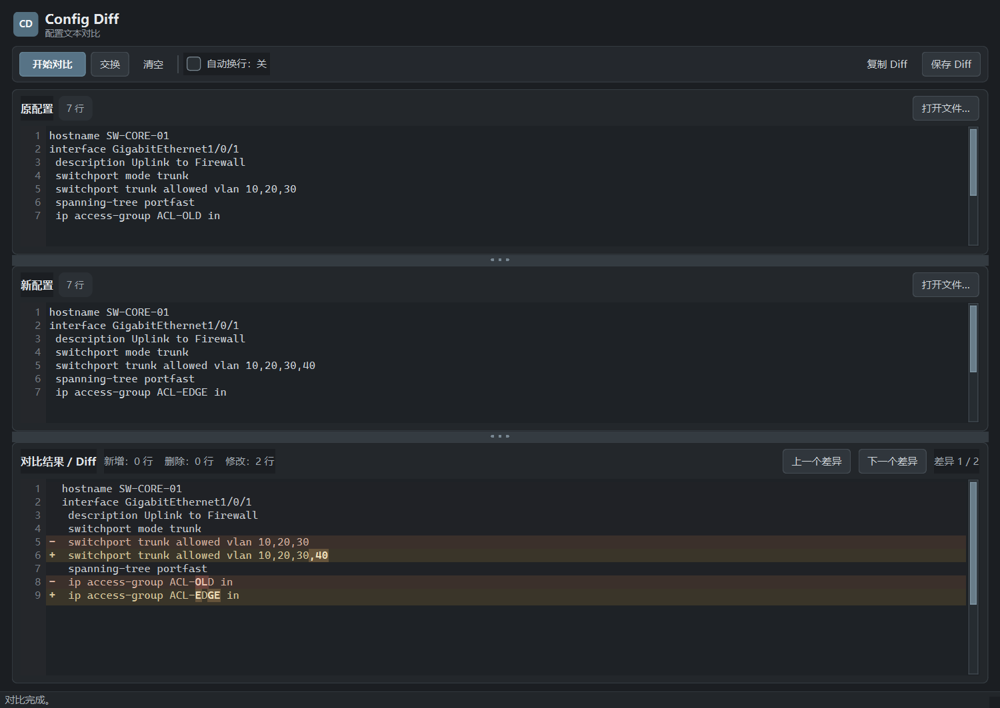

# Config Diff | Windows 配置对比与 Text Diff 工具

<p align="center">
  <strong>快速比较两份配置、代码或文本，直接看清每一处变化。</strong><br>
  A lightweight Windows configuration and text diff tool for network configs, code, and logs.
</p>

<p align="center">
  
  
  
</p>

<p align="center">
  <a href="https://github.com/CooperLee-cyber/ConfigDiff/raw/refs/heads/main/ConfigDiff.exe"><strong>⬇ 下载 Windows EXE</strong></a>
  &nbsp;·&nbsp;
  <a href="#使用方法">使用方法</a>
  &nbsp;·&nbsp;
  <a href="#english">English</a>
</p>

<p align="center">
  
</p>

## 适合什么场景

Config Diff 是一个免费的 Windows 配置文件对比和文本差异比较工具。它适合检查网络设备配置变更，也可比较代码片段、日志、普通文本及其他纯文本文件。无需安装 Python，下载 EXE 后即可运行。

- **一眼看出改动：** 新增、删除和修改使用不同颜色；修改行还会标出具体变化的字符。
- **专为长配置设计：** 原配置、新配置和 Diff 结果支持自动换行，也可以关闭换行并横向滚动。
- **快速定位：** 按差异逐项跳转，拖动分隔条调整三个工作区的大小。
- **轻松导出：** 复制对比结果，或保存为 TXT 和标准 unified diff 文件。
- **中文友好：** 支持 UTF-8、UTF-8 BOM、UTF-16 BOM 及常见本地编码。
- **无需环境配置：** Windows 单文件 EXE，打开即用。

## 使用方法

1. 点击上方 **下载 Windows EXE**，或从仓库文件列表下载 [`ConfigDiff.exe`](ConfigDiff.exe)。
2. 双击运行，在“原配置”和“新配置”区域粘贴文本，或打开配置文件。
3. 点击 **开始对比**（也可以按 `Ctrl+Enter`）。
4. 用 **上一个差异 / 下一个差异** 或 `F7` / `F8` 浏览改动。

新增为绿色、删除为红色、修改为暖色。勾选 **自动换行** 可在窄窗口里阅读长行；关闭时可用水平滚动查看原始行。

## 从源码运行与构建

需要 Windows 和 Python 3.12（或兼容当前 PySide6 的 Python 版本）。

```powershell
python -m venv .venv
.\.venv\Scripts\python.exe -m pip install -r requirements.txt
.\.venv\Scripts\python.exe main.py
```

在项目目录运行 `build.bat` 可重新构建独立 EXE。构建文件会输出到 `dist\ConfigDiff.exe` 并复制到项目根目录。

## 技术与测试

界面使用 PySide6；核心差异算法、文件读写和 UI 分开放在 `configdiff/` 中。自动测试：

```powershell
.\.venv\Scripts\python.exe -m unittest discover -s tests -v
```

## English

**Config Diff** is a free Windows desktop app for comparing configuration files and plain text. Review network device configuration changes, code snippets, logs, or any text file with line-level diff and inline character highlights. The standalone EXE runs without a Python installation.

Features include automatic word wrap, resizable panes, next/previous change navigation, clipboard copy, TXT and unified diff export, and UTF-8 / UTF-16 file support. Download [`ConfigDiff.exe`](https://github.com/CooperLee-cyber/ConfigDiff/raw/refs/heads/main/ConfigDiff.exe), open it, paste or load two files, and click **开始对比**.

**Search terms:** Windows diff tool, text diff, text comparison, configuration diff, config diff, network configuration comparison, network device config diff, compare config files, 文本对比, 配置对比, 配置差异, 网络设备配置对比, Windows 配置文件对比。
